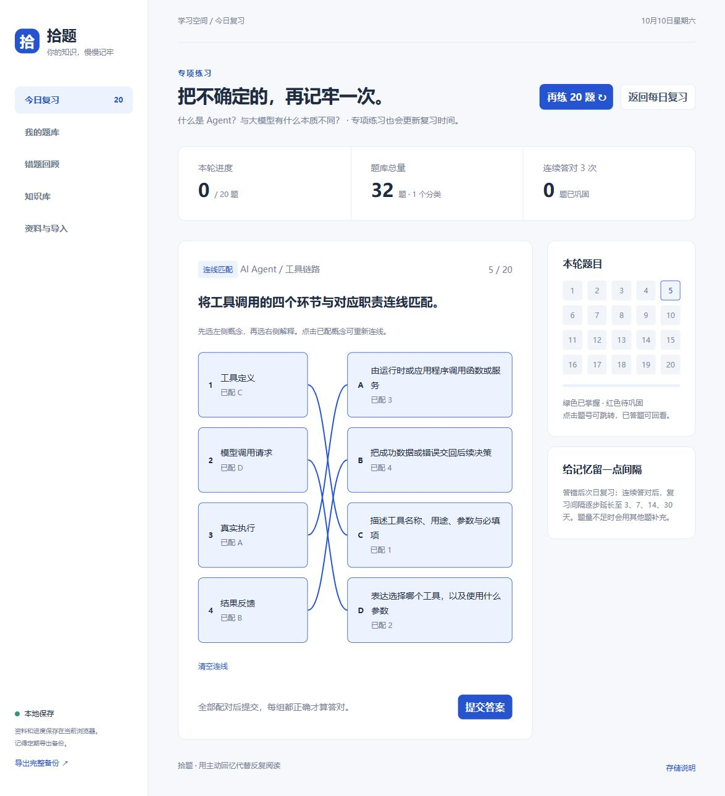

# 拾题 · Questionback

本地运行的八股文复习网页，支持知识库、每日 20 题、加练、错题、收藏、五种题型及答案解析。资料通过 Agent 整理一次，日常练习不需要 AI 服务或 API Key。

## 新电脑运行（无需编程基础）

安装 Git 和 Node.js 20+，打开终端运行：

```sh
git clone https://github.com/Young501/Questionback.git
cd Questionback
node server.cjs
```

浏览器打开 **http://127.0.0.1:4173/**。Windows 也可双击 `启动拾题.cmd`。没有第三方依赖，不需要 npm install，没有构建步骤。其他系统用 Node 命令，自动打开浏览器的 `--open` 参数仅适用于 Windows。

可选命令：`npm start` 启动、`npm test` 验证、`npm run export:pack` 导出学习包。终端按 Ctrl+C 停止服务。

## 当前内容与行为

- 正式内容：Agent 入门，1 篇笔记、11 章、32 道题。原始 PDF 在 `资料/`，导出的 JSON 与 Markdown 在 `整理/`。
- 单选、多选、判断、连线匹配自动判分；简答／回忆题对照答案自评。每题有解析和出处。
- 每日最多 20 道不同题，已开始的本轮保持固定；加练优先避开上一轮，刷新后继续当前加练及已提交答案。
- 错题次日到期；连续答对后的复习间隔为 1、3、7、14、30 天。到期错题优先，题量不足时用其他题补充。
- 知识库可按章节阅读、导出 Markdown、练习关联题；收藏和错题支持筛选与专项练习。
- 用户偏好：每 20 题仅 1–2 道简答，其余优先选择、判断、匹配。新每日、加练、整篇知识练习在客观题充足时最多 2 道简答，没有简答则全用客观题，客观题不足时才用更多简答补足。收藏和错题专项按用户所选范围抽取。
- 网页可保存 TXT/MD 或粘贴的资料，但不会自行生成语义题目。PDF 等资料交给 Agent 整理后生成学习包。

## 换电脑与备份

**GitHub 同步代码和仓库内资料，不同步浏览器学习进度。** 收藏、作答、手动导入内容等保存在当前浏览器的 localStorage。

旧电脑点击「导出完整备份」，新电脑在「资料与导入 → 恢复浏览器备份」导入。恢复会替换新电脑当前数据，先备份再恢复。固定使用同一浏览器及地址；localhost 与 127.0.0.1 的存储不同。

详细步骤见 [迁移与备份](docs/MIGRATION.md)。

## 给新电脑的 Agent

先读 [AGENTS.md](AGENTS.md)，再读 [开发与架构](docs/DEVELOPMENT.md)。新增资料与题库格式见 [学习包指南](docs/LEARNING_PACKS.md)。可将下面这段话交给 Agent：

> 请接手 Questionback。先阅读 AGENTS.md、README.md 和 docs/ 文档，运行 node verify.cjs 确认基线。遵守每 20 题 1–2 道简答的偏好，保留已有学习进度。使用 node server.cjs 启动，地址固定为 http://127.0.0.1:4173/。不要重置 localStorage，也不要把 demo.js 加回正式页面。随后根据我的需求继续修改。

## 验证与导出

```sh
node verify.cjs
node build-learning-pack.cjs
```

验证使用内存 DOM/storage 替身，不修改真实浏览器记录；导出命令更新 `整理/` 中的 JSON 与 Markdown。项目没有配置自动部署，推送代码不会发布运行网站。



原始学习资料权利归原作者，保留来源信息，未另行授予第三方资料许可。应用不会把资料和作答数据发送到网络。
